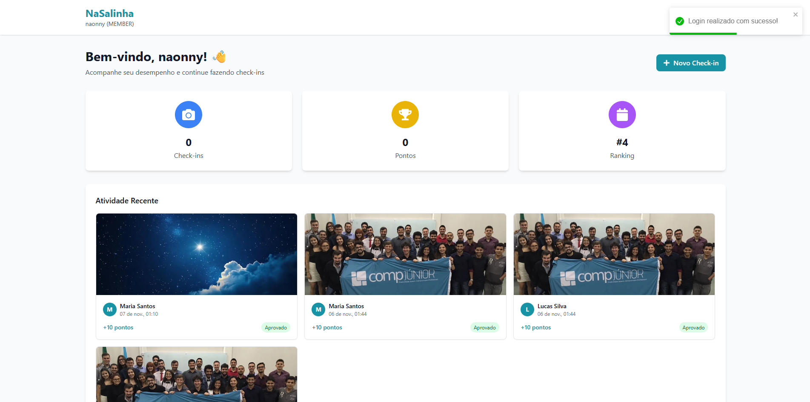
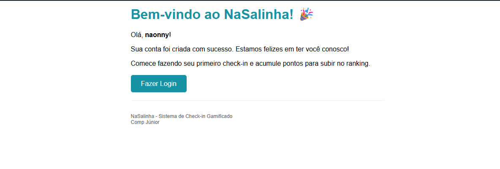
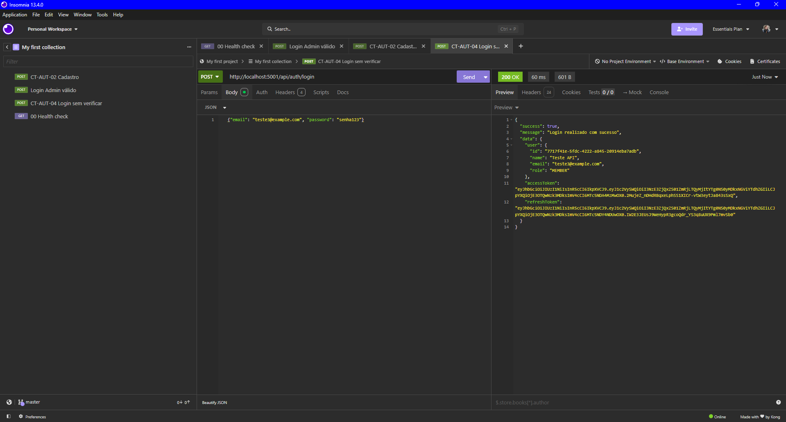

# BUG-AUTH-01: Login liberado para conta que não verificou o e-mail

- **Área:** Autenticação (JWT)
- **Requisito violado:** RF-02 (Restrição de Login)
- **Casos de teste:** CT-AUT-03 (interface), CT-AUT-04 (API) e CT-AUT-02 (cadastro, relacionado)
- **Localização:** Backend / API (`POST /api/auth/login`)
- **Ambiente:** localhost, Docker Compose, NaSalinha (Node.js + PostgreSQL)
- **Data:** 07/11/2026
- **Severidade:** Maior (erro de lógica em regra de acesso)
- **Status:** Aberto

## Passos para reproduzir (API)

1. Enviar `POST http://localhost:5001/api/auth/register` com um e-mail novo
   (ex.: teste3@example.com) e uma senha.
2. Não realizar nenhuma verificação de conta (o sistema não oferece código de
   verificação, ver BUG-AUTH-02).
3. Enviar `POST http://localhost:5001/api/auth/login` com o mesmo e-mail e senha.

## Passos para reproduzir (interface)

1. Em http://localhost:3000, cadastrar um usuário novo.
2. Sem verificar o e-mail, tentar entrar com ele.

## Resultado esperado

Login bloqueado, com a mensagem "Por favor, verifique sua conta para continuar"
e nenhum token na resposta (status 401 ou 403).

## Resultado atual

- API: status 200 OK com a mensagem "Login realizado com sucesso" e com
  `accessToken` e `refreshToken` na resposta.
- Interface: o usuário entra no sistema normalmente, sem verificar a conta.

## Consequência

Qualquer pessoa pode criar uma conta com um e-mail que não controla e usar o
sistema normalmente. A verificação de e-mail exigida pelo RF-02 não tem efeito.

## Análise técnica

Pelo comportamento observado, o endpoint de login emite os tokens sem consultar
o status da conta (PENDENTE). A correção deve incluir essa checagem antes da
emissão dos tokens, com resposta 401 ou 403 e a mensagem definida no RF-02.

## Observações

- O e-mail recebido após o cadastro é uma mensagem de boas-vindas e não contém
  código de verificação (BUG-AUTH-02).
- O cadastro (`POST /api/auth/register`) também devolve `accessToken` e
  `refreshToken` na resposta, antes de qualquer verificação (CT-AUT-02).

## Evidências

- 
- 
- 
- 
