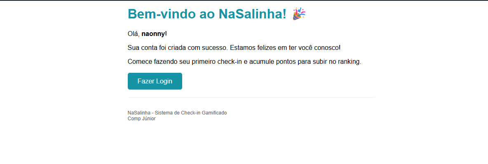

# BUG-AUTH-02: E-mail pós-cadastro não contém código de verificação

- **Área:** Autenticação (JWT)
- **Requisito violado:** RF-01 (Cadastro e Verificação)
- **Caso de teste:** CT-AUT-01
- **Localização:** Backend (envio de e-mail)
- **Ambiente:** localhost, Docker Compose, Mailtrap (Sandbox)
- **Data:** 07/11/2026
- **Severidade:** Maior (fluxo de ativação da conta não implementado)

## Passos para reproduzir

1. Em http://localhost:3000, cadastrar um usuário novo.
2. Abrir a caixa de entrada do Mailtrap.
3. Abrir o e-mail recebido após o cadastro.

## Resultado esperado

E-mail com um código de verificação único, para o usuário ativar a conta
(status inicial PENDENTE).

## Resultado atual

Status 200 com 5 check-ins, todos de outros usuários e nenhum do Pedro:
2 de "Maria Santos" (maria@example.com), 2 de "Lucas Silva"
(lucas@example.com) e 1 de "naonny" (teste2@example.com). Cada item expõe
e-mail e ID do dono.
## Análise de causa raiz (hipótese)

O template de e-mail enviado no cadastro parece ser o de boas-vindas, e o código
de verificação não é gerado nem incluído. Hipótese a confirmar no código do
serviço de e-mail, que não foi lido nesta auditoria.

## Observações

- Não existe, na interface, campo para digitar um código de verificação.
- Consequência: não há como ativar a conta, e o sistema libera o acesso sem
  verificação (ver BUG-AUTH-01).

## Evidências

- 
