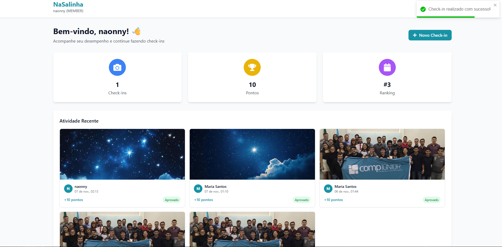
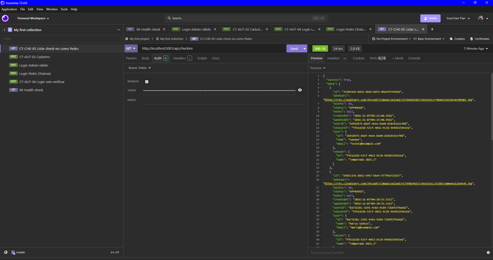

# BUG-CHK-01: Check-in nasce com status APROVADO e já com pontos

- **Área:** Check-in por Foto
- **Requisito violado:** RF-05 (Fluxo de Status do Check-in)
- **Casos de teste:** CT-CHK-03 (interface) e CT-CHK-04 (API)
- **Localização:** Backend (criação do check-in)
- **Ambiente:** localhost, Docker Compose, NaSalinha (Node.js + PostgreSQL)
- **Data:** 07/11/2026
- **Severidade:** Maior (erro de lógica no fluxo de status)

## Passos para reproduzir

1. Entrar como Pedro (pedro@example.com).
2. Fazer um check-in com uma foto.
3. Olhar o status do check-in na interface, ou enviar
   `GET http://localhost:5001/api/checkins` com o token do usuário.

## Resultado esperado

Status inicial PENDENTE. Só o Administrador altera para Aprovado ou Rejeitado.

## Resultado atual

- Interface: o check-in aparece como "Aprovado".
- API: `"status": "APPROVED"` e `"points": 10` no check-in recém-criado, com
  `createdAt` igual a `updatedAt` (ninguém alterou o status depois).
- Exemplo: o check-in 33307ed3-b831-4036-bd75-046ef9794858, criado pelo
  testador pela interface, tem `status: APPROVED`, `points: 10` e
  `createdAt` igual a `updatedAt`.

## Consequência

O Administrador não tem o que aprovar ou rejeitar (não foi possível mudar o
status na exploração, linha 17), então a etapa de moderação fica inútil.

## Análise de causa raiz (hipótese)

O valor padrão do status na criação do check-in parece ser APPROVED, e não
PENDING. Hipótese a confirmar no código (schema do Prisma ou serviço de
check-ins), que não foi lido nesta auditoria.

## Evidências

- 
- 
