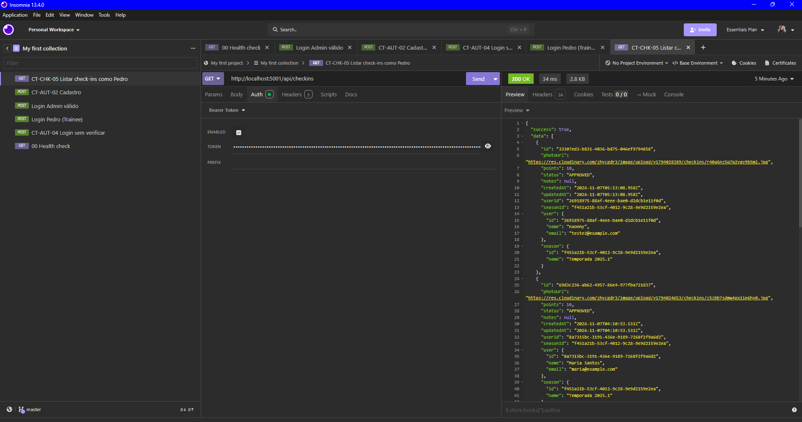
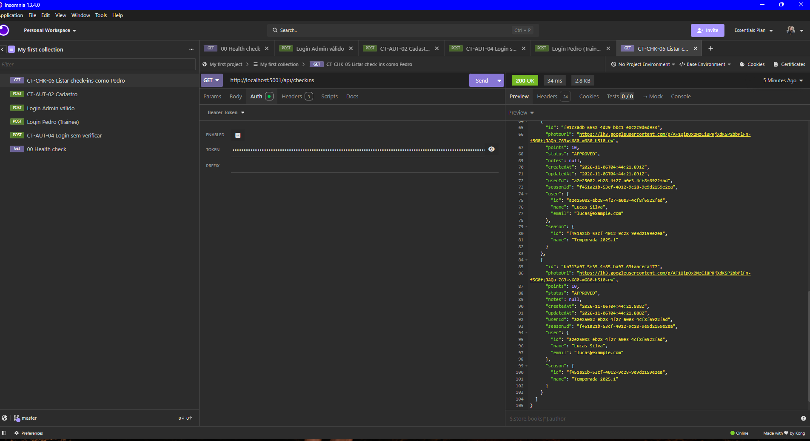
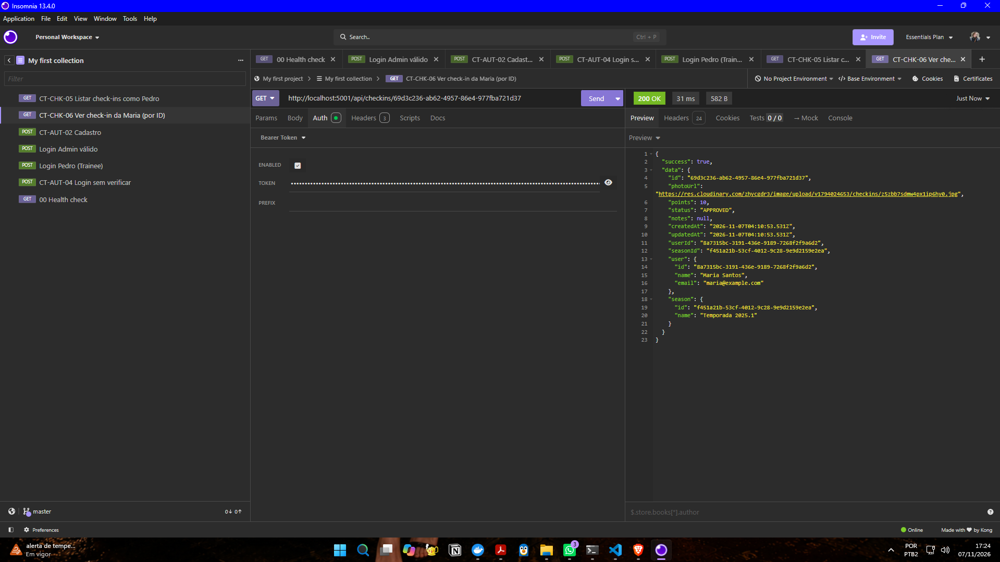
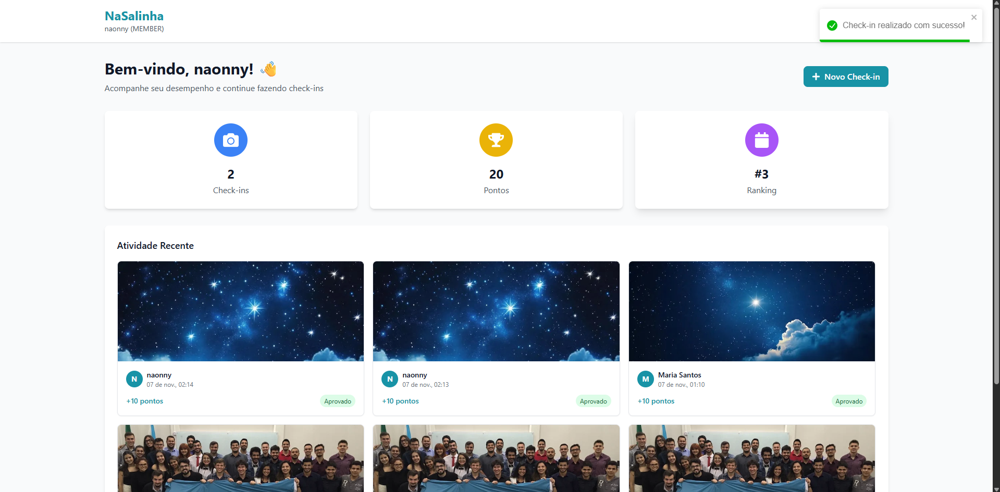

# BUG-CHK-02: Usuário comum lê check-ins de outros usuários

- **Área:** Check-in por Foto
- **Requisito violado:** RF-06 (Restrição de Propriedade)
- **Casos de teste:** CT-CHK-05 (interface) e CT-CHK-06 (API)
- **Localização:** Backend / API (`GET /api/checkins` e `GET /api/checkins/:id`)
- **Ambiente:** localhost, Docker Compose, NaSalinha (Node.js + PostgreSQL)
- **Data:** 07/11/2026
- **Severidade:** Maior (falha no controle de acesso; expõe dados de outros usuários)
- **Status:** Aberto

## Passos para reproduzir (API)

1. Enviar `POST http://localhost:5001/api/auth/login` com pedro@example.com
   (perfil TRAINEE) e copiar o `accessToken`.
2. Enviar `GET http://localhost:5001/api/checkins` com esse token
   (Auth > Bearer Token).
3. Enviar `GET http://localhost:5001/api/checkins/69d3c236-ab62-4957-86e4-977fba721d37`
   com o mesmo token (ID de um check-in da Maria Santos).

## Passos para reproduzir (interface)

1. Em http://localhost:3000, entrar com um usuário comum (no print, a conta
   naonny).
2. Abrir a tela inicial e olhar a seção "Atividade Recente".

## Resultado esperado

- Passo 2 (API): apenas os check-ins do próprio Pedro (ou lista vazia).
- Passo 3 (API): acesso negado (status 403 ou 404).
- Interface: apenas os check-ins do próprio usuário.

## Resultado atual

- Passo 2 (API): status 200 com 5 check-ins, todos de outros usuários e nenhum
  do Pedro: 2 de "Maria Santos", 2 de "Lucas Silva" e 1 de "naonny". Cada item
  expõe e-mail e ID do dono.
- Passo 3 (API): status 200 com os dados completos do check-in da Maria (foto,
  pontos, status, e-mail e ID dela).
- Interface: a lista "Atividade Recente" inclui o check-in da Maria Santos
  (07 de nov., 01:10, +10 pontos), que não pertence ao usuário logado.

## Consequência

Qualquer usuário autenticado consegue ler fotos, pontos e e-mails de outros
usuários, o que expõe dados pessoais e quebra a regra de propriedade do RF-06.

## Análise técnica

Pelo comportamento observado, os endpoints de leitura não comparam o dono do
check-in com o ID do usuário autenticado. A correção deve filtrar a listagem
pelo usuário do token e negar (403 ou 404) a leitura por ID de check-in alheio.

## Observações

- Na interface não há opção para editar nem apagar check-ins de outros
  usuários, mas a tela inicial os exibe (CT-CHK-05, Fail).
- A edição de check-in alheio (`PUT /api/checkins/:id`) foi bloqueada com
  status 403 (CT-CHK-06, passo 4). A falha está na leitura.

## Evidências

- 
- 
- 
- 
