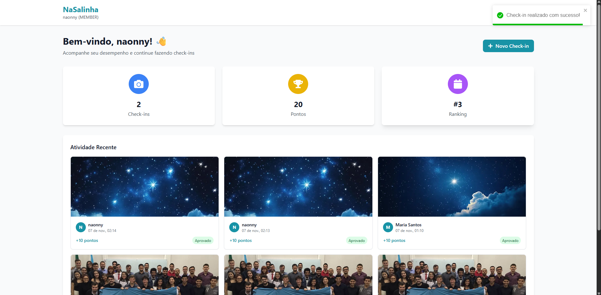

# BUG-CHK-03: Sistema aceita a mesma foto em check-ins repetidos

- **Área:** Check-in por Foto
- **Requisito violado:** RF-04 (restringir o envio da mesma foto repetidas vezes)
- **Caso de teste:** CT-CHK-01
- **Localização:** Backend (validação do upload)
- **Ambiente:** localhost, Docker Compose, NaSalinha (Node.js + PostgreSQL)
- **Data:** 06/11/2026
- **Severidade:** Maior (regra de negócio não aplicada)

## Passos para reproduzir

1. Em http://localhost:3000, entrar como Pedro e fazer um check-in com a foto A.
2. Sair e entrar como Maria.
3. Fazer um check-in com a mesma foto A.

## Resultado esperado

O segundo envio é recusado, porque o sistema deve restringir o envio da mesma
foto repetidas vezes.

## Resultado atual

O check-in com a foto repetida é aceito normalmente.

## Consequência

Um usuário pode reaproveitar a mesma imagem para pontuar, sem comprovar uma
nova atividade. Isso enfraquece a validação de mídia e distorce o ranking.

## Análise de causa raiz (hipótese)

O upload não parece comparar a imagem com envios anteriores (por exemplo, por
hash do arquivo). Hipótese a confirmar no código do serviço de check-in, que
não foi lido nesta auditoria.

## Evidências

- 
