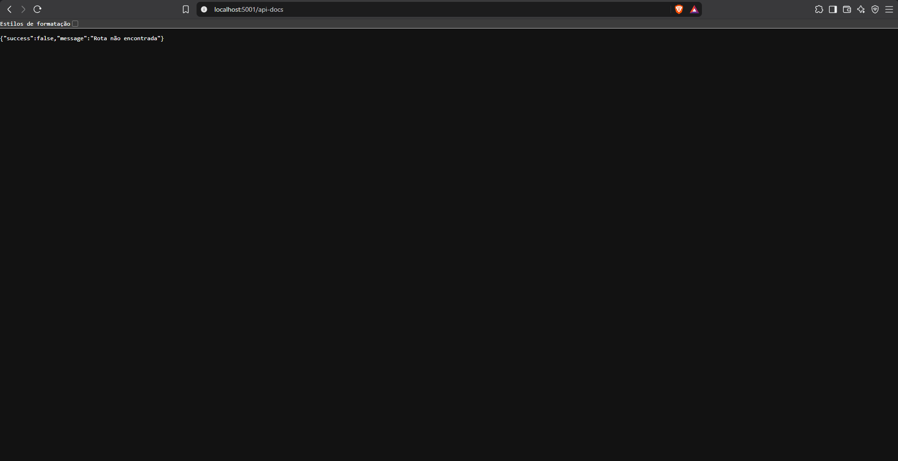

# BUG-DOC-01: Documentação Swagger indicada no README não está disponível

- **Área:** Documentação da API (bug extra, fora das 3 áreas principais)
- **Requisito violado:** não consta no documento de requisitos. Diverge do README do backend, que indica o Swagger em `/api-docs`
- **Caso de teste:** CT-ADHOC-01
- **Localização:** Backend (rota `/api-docs`)
- **Ambiente:** localhost, Docker Compose, NaSalinha (Node.js + PostgreSQL)
- **Data:** 07/11/2026
- **Severidade:** Menor (documentação indisponível, sem impacto nas regras de negócio)
- **Status:** Aberto

## Passos para reproduzir

1. Com o sistema ligado, abrir http://localhost:5001/api-docs no navegador.

## Resultado esperado

Página do Swagger UI com a lista de endpoints, como informa o README do backend
("A documentação interativa Swagger está disponível em
http://localhost:5001/api-docs").

## Resultado atual

Status 404 com a resposta JSON `{"success":false,"message":"Rota não encontrada"}`.

## Consequência

Quem testa ou integra com a API fica sem a referência oficial dos endpoints e
dos campos de cada requisição (por exemplo, o nome do campo de upload da foto).

## Análise técnica

Pelo comportamento observado, a rota `/api-docs` não está registrada no
servidor, embora o README do backend liste as bibliotecas swagger-jsdoc e
swagger-ui-express. A correção deve registrar a rota do Swagger UI no servidor
ou, se a documentação foi descontinuada, atualizar o README.

## Observações

- O servidor está no ar: `GET /health` responde 200 ("NaSalinha API is running").
  A falha é só na rota da documentação.

## Evidências

- 
