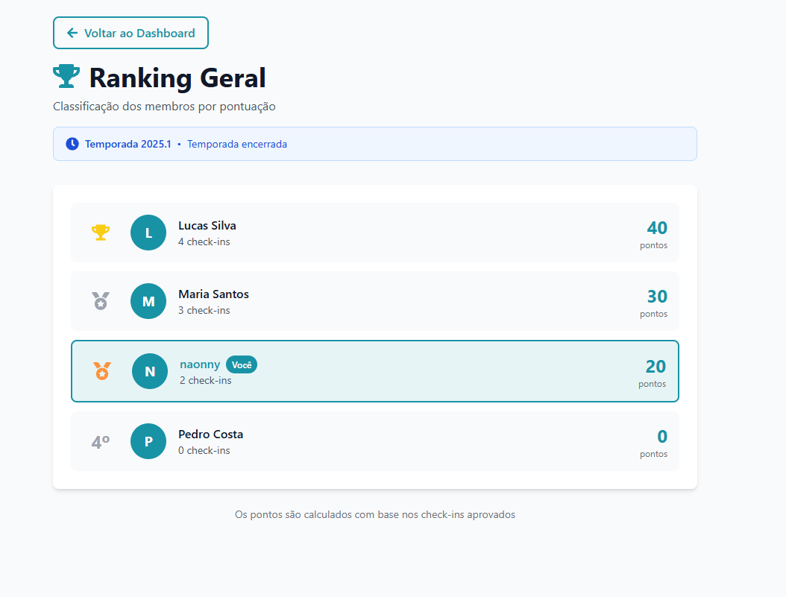
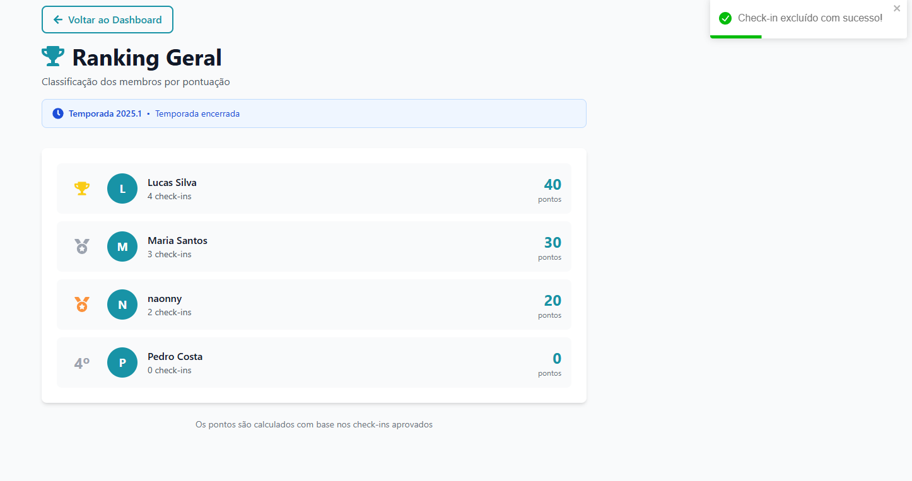
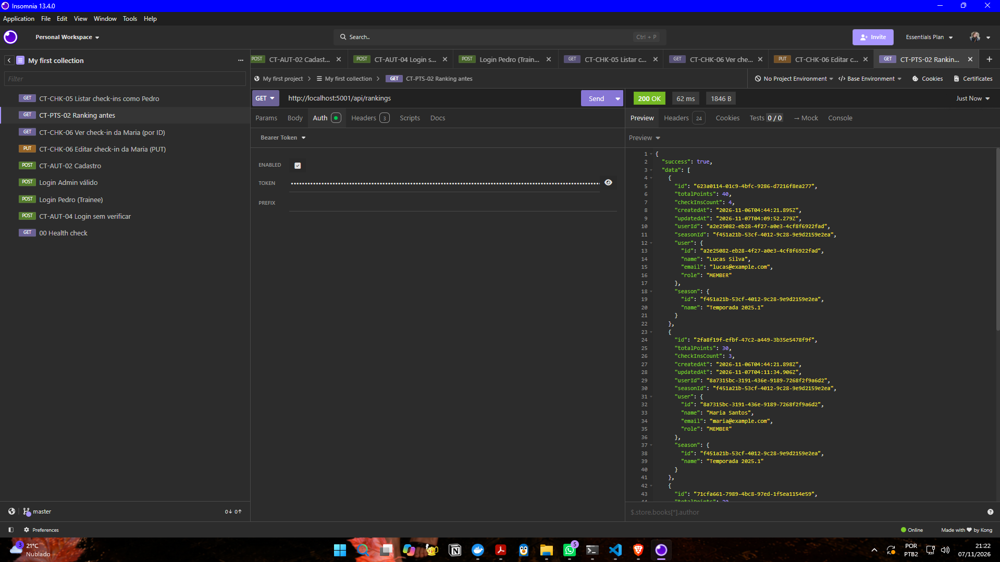
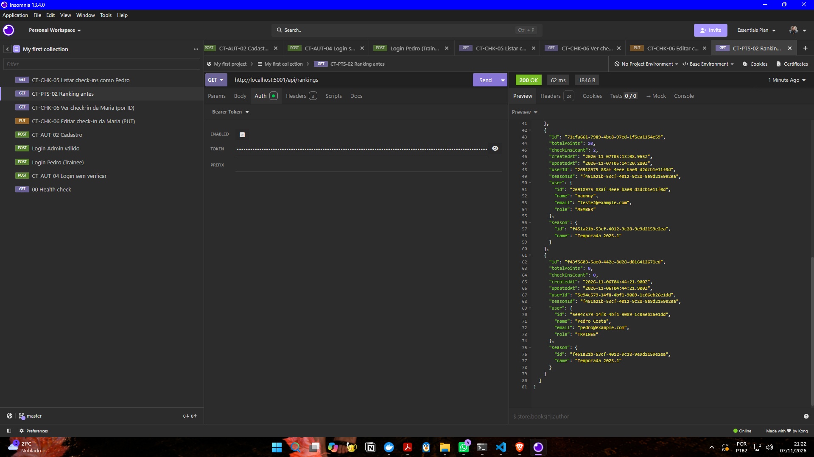
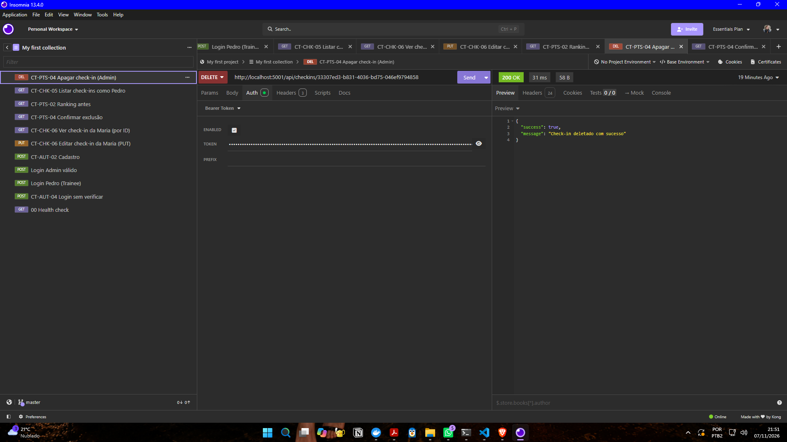
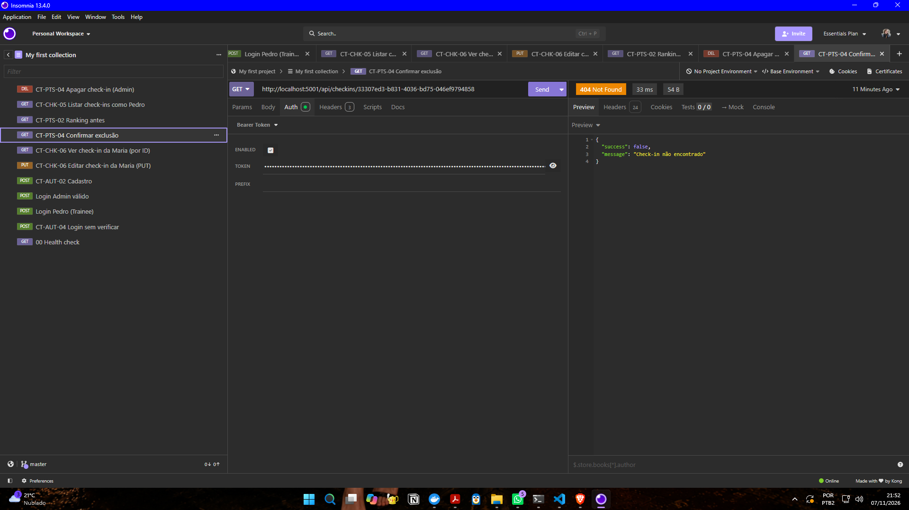
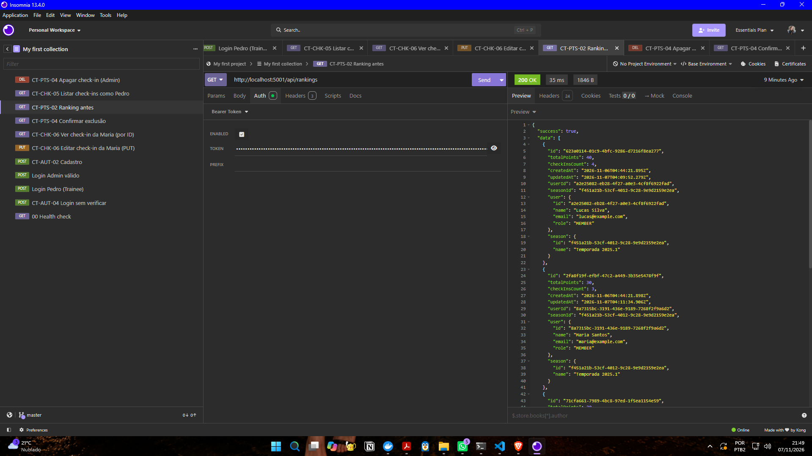
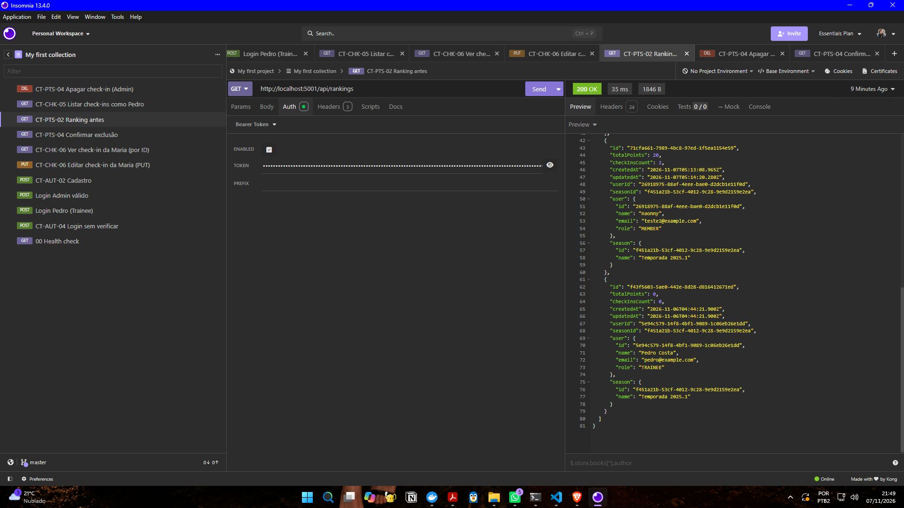

# BUG-PTS-01: Ranking não subtrai pontos nem contagem de check-ins ao apagar um check-in

- **Área:** Sistema de Pontos
- **Requisito violado:** RF-08 (Consistência de Saldo)
- **Casos de teste:** CT-PTS-03 (interface) e CT-PTS-04 (API)
- **Localização:** Backend (exclusão de check-in / atualização do saldo)
- **Ambiente:** localhost, Docker Compose, NaSalinha (Node.js + PostgreSQL)
- **Data:** 07/11/2026
- **Severidade:** Maior (erro de lógica que distorce o ranking)
- **Status:** Aberto

## Passos para reproduzir (API)

1. Enviar `POST http://localhost:5001/api/auth/login` com admin@nasalinha.com
   e copiar o `accessToken`.
2. Enviar `GET http://localhost:5001/api/rankings` e anotar o usuário "naonny"
   (teste2@example.com): `totalPoints: 20` e `checkInsCount: 2`.
3. Enviar `DELETE http://localhost:5001/api/checkins/33307ed3-b831-4036-bd75-046ef9794858`
   com o token do Admin (check-in de 10 pontos do naonny).
   Resposta: 200 "Check-in deletado com sucesso".
4. Enviar `GET http://localhost:5001/api/checkins/33307ed3-b831-4036-bd75-046ef9794858`.
   Resposta: 404 (o check-in foi realmente removido).
5. Enviar `GET http://localhost:5001/api/rankings` de novo.

## Passos para reproduzir (interface)

1. Entrar como Admin e abrir o ranking, anotando os pontos.
2. Apagar um check-in.
3. Abrir o ranking de novo.

## Resultado esperado

Ao apagar o check-in, o saldo do usuário diminui os 10 pontos dele e a contagem
diminui 1 check-in. No exemplo da API, naonny passa de 20 pontos e 2 check-ins
para 10 pontos e 1 check-in.

## Resultado atual

- API: o ranking após a exclusão é idêntico ao de antes. naonny continua com
  `totalPoints: 20` e `checkInsCount: 2`, e o `updatedAt` não mudou.
- Interface: ao apagar check-ins como Admin, a pontuação do ranking não
  diminuiu (exploração, linha 19).

## Consequência

Usuários mantêm pontos de check-ins que não existem mais, e o ranking deixa de
refletir a atividade real da temporada.

## Análise técnica

Pelo comportamento observado, a rota de exclusão remove o registro do check-in,
mas não atualiza a tabela de pontos (saldo e contagem). A correção deve subtrair
os pontos do check-in apagado e reduzir a contagem na mesma operação da
exclusão.

## Observações

- Depois da exclusão, a listagem de check-ins não tem mais nenhum check-in do
  naonny, mas o ranking mantém 20 pontos e 2 check-ins.
- A listagem de check-ins mostrava 2 do Lucas e 2 da Maria, enquanto o ranking
  contabiliza 4 e 3 check-ins (40 e 30 pontos). É um indício de que as
  exclusões anteriores também não foram descontadas.

## Evidências

- 
- 
- 
- 
- 
- 
- 
- 
