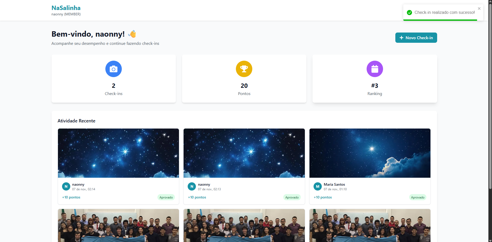

# BUG-PTS-02: Sistema aceita dois check-ins seguidos do mesmo usuário

- **Área:** Sistema de Pontos
- **Requisito violado:** RF-09 (intervalo mínimo de 24 horas) e RF-04 (apenas um check-in por dia)
- **Caso de teste:** CT-PTS-06
- **Localização:** Backend (regra de criação de check-in)
- **Ambiente:** localhost, Docker Compose, NaSalinha (Node.js + PostgreSQL)
- **Data:** 06/11/2026
- **Severidade:** Maior (erro de lógica em regra de negócio)

## Passos para reproduzir

1. Em http://localhost:3000, entrar como Pedro (pedro@example.com, Trainee).
2. Fazer um check-in com uma foto.
3. Sem esperar, fazer um segundo check-in.
4. Abrir o ranking e conferir os pontos do Pedro.

## Resultado esperado

O segundo check-in é recusado, porque o mesmo usuário só pode fazer um check-in
por dia, com intervalo mínimo de 24 horas entre eles.

## Resultado atual

O segundo check-in é aceito e os pontos são somados ao saldo do usuário.

## Consequência

Um usuário pode repetir check-ins sem limite e acumular pontos, o que
distorce o ranking e a competição da temporada.

## Observações

- A versão pela API (POST /api/checkins duas vezes seguidas) não foi executada.
  O comportamento foi comprovado pela interface.
- Relacionado: a "Temporada 2025.1" está ativa com data final em 30/06/2025
  (ver observações em 02-execucao-api.md).

## Análise de causa raiz (hipótese)

O endpoint de criação de check-in parece não consultar o último check-in do
usuário antes de gravar um novo. Hipótese a confirmar no código do
controller/service de check-ins, que não foi lido nesta auditoria.

## Evidências

- 
